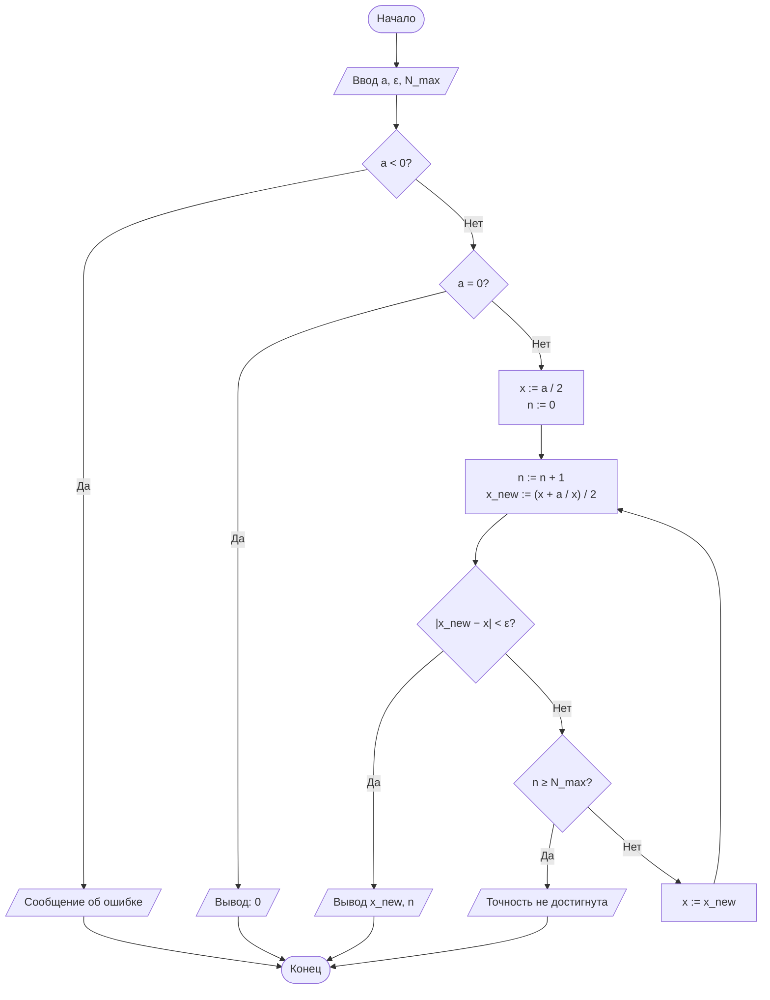
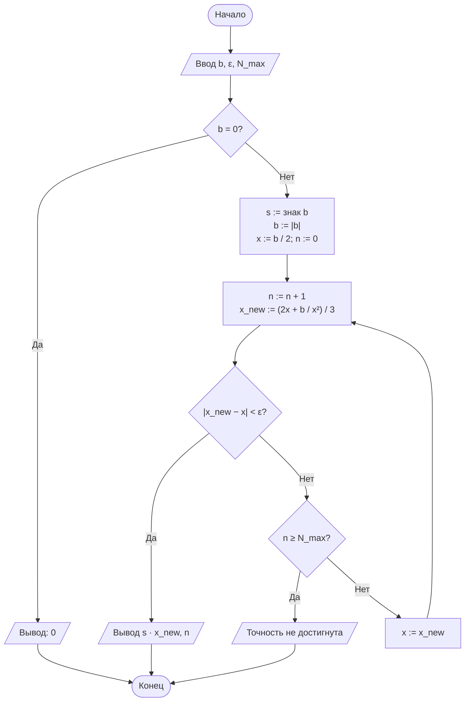
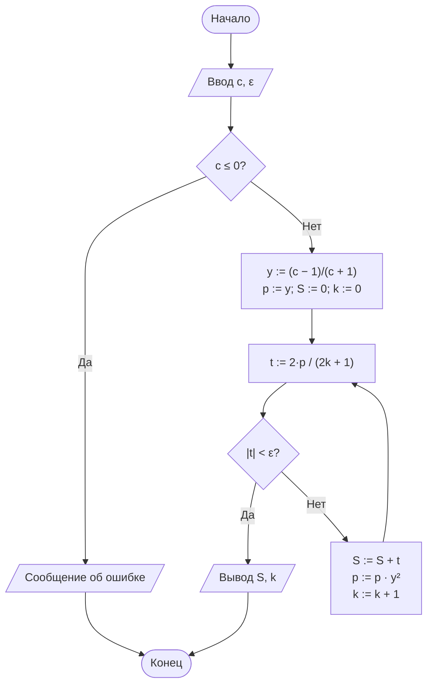

# Лабораторная работа № 1. Вариант 13

**Итерационные методы вычисления элементарных функций: квадратный корень, кубический корень и натуральный логарифм**

| | |
|---|---|
| **Дисциплина** | Теория алгоритмов |
| **Направление** | 38.03.05 «Бизнес-информатика» |
| **Выполнила** | Кугушева Арина Вячеславовна |
| **Группа** | БИ 2-1 |
| **Вариант** | 13 |
| **Язык** | Python 3.10+ |

## Файлы работы

| Файл | Назначение |
|---|---|
| [`otchet_lr1_variant13.pdf`](otchet_lr1_variant13.pdf) | Отчёт (титульный лист, теория, блок-схемы, листинг, результаты, выводы) |
| [`README.md`](README.md) | Описание работы (этот файл) |
| [`lab1_variant13.py`](lab1_variant13.py) | Программа |

## Запуск

```bash
python lab1_variant13.py
```

Внешние библиотеки не нужны (используется только стандартный модуль `math` — для эталонных значений и для `log10` при подсчёте верных знаков).

## 1. Задание варианта 13

Вычислить √31, ∛100 и ln 0,2 с точностью ε = 10⁻⁵.

| a | b | c | ε | Критерий остановки | x₀ | Доп. |
|---|---|---|---|---|---|---|
| 31 | 100 | 0,2 | 10⁻⁵ | Р — по разности соседних приближений | a/2 | Д1 |

- √a и ∛b вычисляются методом Ньютона, ln c — разложением в степенной ряд.
- Начальное приближение x₀ = a/2 (для кубического корня x₀ = b/2).
- Внутри вычислительных функций не используются `math.sqrt`, `math.log` и `**0.5`; `math` применяется только для эталонных значений.
- Каждая функция возвращает пару «результат, число итераций».
- **Д1:** таблица итераций для каждой функции (номер шага, xₙ, |xₙ₊₁ − xₙ|) и анализ изменения числа верных знаков.

## 2. Теория кратко

Метод Ньютона для F(x) = 0: x₍ₙ₊₁₎ = xₙ − F(xₙ)/F′(xₙ).

- √a (формула Герона): x₍ₙ₊₁₎ = ½ (xₙ + a/xₙ)
- ∛b: x₍ₙ₊₁₎ = ⅓ (2xₙ + b/xₙ²)
- ln c = 2 (y + y³/3 + y⁵/5 + …), y = (c − 1)/(c + 1); для c = 0,2: y = −2/3. Суммирование идёт, пока |tₖ| ≥ ε.

Метод Ньютона сходится квадратично (число верных знаков примерно удваивается за шаг), ряд для логарифма — линейно.

## 3. Блок-схемы

### √a



### ∛b



### ln c



## 4. Результаты

**Таблица 1. Результаты вычислений (ε = 10⁻⁵)**

| Функция | Аргумент | Результат | Эталон (`math`) | Абс. погрешность | Итераций |
|---|---|---|---|---|---|
| √a | 31 | 5.5677643628 | 5.5677643628 | 8.88e-16 | 6 |
| ∛b | 100 | 4.6415888336 | 4.6415888336 | 1.28e-13 | 10 |
| ln c | 0.2 | -1.6094247670 | -1.6094379124 | 1.31e-05 | 11 |

### Д1. Таблицы итераций

«Верных знаков» — число верных десятичных знаков после запятой, −lg|xₙ − x\*|.

**√31 (x₀ = 15,5)**

| Шаг | xₙ | \|разность\| | Погрешность | Верных знаков |
|---:|---:|---:|---:|---:|
| 0 | 15.5000000000 | — | 9.93e+00 | 0.00 |
| 1 | 8.7500000000 | 6.75e+00 | 3.18e+00 | 0.00 |
| 2 | 6.1464285714 | 2.60e+00 | 5.79e-01 | 0.24 |
| 3 | 5.5950039429 | 5.51e-01 | 2.72e-02 | 1.56 |
| 4 | 5.5678306715 | 2.72e-02 | 6.63e-05 | 4.18 |
| 5 | 5.5677643632 | 6.63e-05 | 3.95e-10 | 9.40 |
| 6 | 5.5677643628 | 3.95e-10 | 8.88e-16 | 15.05 |

**∛100 (x₀ = 50)**

| Шаг | xₙ | \|разность\| | Погрешность | Верных знаков |
|---:|---:|---:|---:|---:|
| 0 | 50.0000000000 | — | 4.54e+01 | 0.00 |
| 1 | 33.3466666667 | 1.67e+01 | 2.87e+01 | 0.00 |
| 2 | 22.2610871255 | 1.11e+01 | 1.76e+01 | 0.00 |
| 3 | 14.9079892640 | 7.35e+00 | 1.03e+01 | 0.00 |
| 4 | 10.0886420142 | 4.82e+00 | 5.45e+00 | 0.00 |
| 5 | 7.0532628641 | 3.04e+00 | 2.41e+00 | 0.00 |
| 6 | 5.3722119659 | 1.68e+00 | 7.31e-01 | 0.14 |
| 7 | 4.7364493295 | 6.36e-01 | 9.49e-02 | 1.02 |
| 8 | 4.6434759942 | 9.30e-02 | 1.89e-03 | 2.72 |
| 9 | 4.6415896005 | 1.89e-03 | 7.67e-07 | 6.12 |
| 10 | 4.6415888336 | 7.67e-07 | 1.28e-13 | 12.89 |

**ln 0,2 (xₖ — частичная сумма ряда из k членов; в столбце «разность» — модуль очередного члена |tₖ|)**

| Шаг | Sₖ | \|разность\| | Погрешность | Верных знаков |
|---:|---:|---:|---:|---:|
| 0 | 0.0000000000 | 1.33e+00 | 1.61e+00 | 0.00 |
| 1 | -1.3333333333 | 1.98e-01 | 2.76e-01 | 0.56 |
| 2 | -1.5308641975 | 5.27e-02 | 7.86e-02 | 1.10 |
| 3 | -1.5835390947 | 1.67e-02 | 2.59e-02 | 1.59 |
| 4 | -1.6002612842 | 5.78e-03 | 9.18e-03 | 2.04 |
| 5 | -1.6060417942 | 2.10e-03 | 3.40e-03 | 2.47 |
| 6 | -1.6081437978 | 7.90e-04 | 1.29e-03 | 2.89 |
| 7 | -1.6089342949 | 3.04e-04 | 5.04e-04 | 3.30 |
| 8 | -1.6092387827 | 1.19e-04 | 1.99e-04 | 3.70 |
| 9 | -1.6093581896 | 4.75e-05 | 7.97e-05 | 4.10 |
| 10 | -1.6094056731 | 1.91e-05 | 3.22e-05 | 4.49 |
| 11 | -1.6094247670 | 7.75e-06 | 1.31e-05 | 4.88 |

## 5. Анализ результатов и выводы

1. Все три алгоритма достигли заданной точности ε = 10⁻⁵: √31 ≈ 5,5677643628 (6 итераций), ∛100 ≈ 4,6415888336 (10 итераций), ln 0,2 ≈ −1,6094247670 (11 членов ряда).
2. **Квадратичная сходимость метода Ньютона.** Для √31 число верных знаков по шагам: 0; 0; 0,24; 1,56; 4,18; 9,40; 15,05, то есть на последних шагах оно почти удваивается, а погрешность падает как eₙ₊₁ ≈ C·eₙ²: 2,7·10⁻² → 6,6·10⁻⁵ → 3,9·10⁻¹⁰ → 8,9·10⁻¹⁶. Фактическая погрешность на много порядков меньше ε, так как разность |xₙ − xₙ₋₁| оценивает погрешность *предыдущего* приближения.
3. **Влияние начального приближения.** x₀ = a/2 далеко от корня. Пока xₙ много больше корня, метод ведёт себя почти линейно: для ∛100 каждый шаг уменьшает x примерно в 1,5 раза (50 → 33,3 → 22,3 → 14,9 → 10,1 → 7,05), и первые 5 шагов не дают ни одного верного знака. Квадратичный режим наступает только вблизи корня (1,02 → 2,72 → 6,12 → 12,89 верных знаков на шагах 7–10). Поэтому ∛100 потребовал 10 итераций против 6 для √31.
4. **Линейная сходимость ряда.** Для ln 0,2: y = −2/3, y² ≈ 0,444, члены убывают примерно в 2,5 раза за шаг, число верных знаков растёт почти равномерно — на ≈0,4 за шаг. Для ε = 10⁻¹⁵ потребовалось бы 38 членов (проверено расчётом).
5. **Фактическая погрешность может превышать ε.** Для ln 0,2 она равна 1,31·10⁻⁵ > ε = 10⁻⁵: критерий |tₖ| < ε гарантирует малость только очередного члена, но не всего отброшенного «хвоста» ряда. Для строгой гарантии нужно ужесточить критерий (например, |tₖ| < ε·(1 − y²)) или учитывать оценку хвоста |tₖ|/(1 − y²).
6. Для логарифма аргументов, далёких от 1, целесообразна нормализация c = m·2ᵏ: |y| уменьшается, ряд сходится быстрее.

**Вывод.** Итерационные методы позволили вычислить √31, ∛100 и ln 0,2 с заданной точностью без встроенных функций. Метод Ньютона (квадратичная сходимость) значительно эффективнее степенного ряда (линейная сходимость), но его скорость сильно зависит от выбора начального приближения. Результаты согласуются с эталонами `math`.

## 6. Литература

1. Кнут Д. Э. Искусство программирования. Т. 1. Основные алгоритмы. — 3-е изд. — М.: Вильямс, 2017.
2. Вирт Н. Алгоритмы и структуры данных. Новая версия для Оберона. — М.: ДМК Пресс, 2016.
3. Вержбицкий В. М. Основы численных методов. — М.: Высшая школа, 2009.
4. Бахвалов Н. С., Жидков Н. П., Кобельков Г. М. Численные методы. — 9-е изд. — М.: Лаборатория знаний, 2020.
5. ГОСТ 19.701-90 (ИСО 5807-85). ЕСПД. Схемы алгоритмов, программ, данных и систем. Условные обозначения и правила выполнения.
